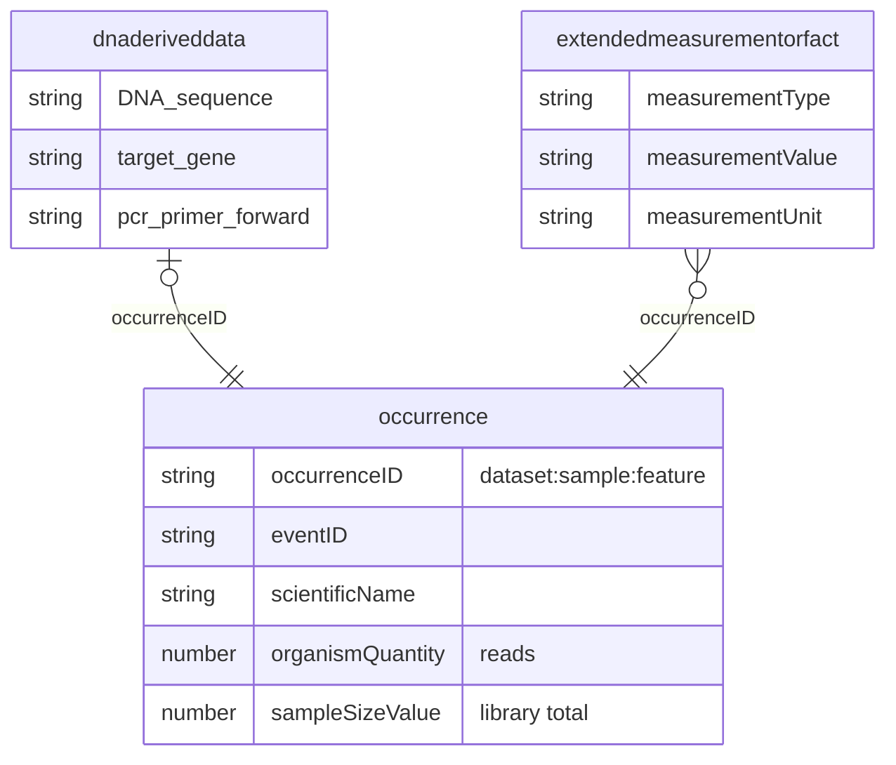

# Archive contents

This page describes what `build` writes into the archive directory, how it writes it, and how the archive is checked. [Dataset metadata](metadata.md) covers `eml.xml`, [Term mapping](term-mapping.md) the columns, [Derived fields](derived-fields.md) the values `build` works out, and [Reproducibility](reproducibility.md) the `reproduce/` directory.

## Files

| File | Contents |
| --- | --- |
| `occurrence.txt` | The core: one row per feature (ASV or OTU) per sample |
| `dnaderiveddata.txt` | DNADerivedData extension, keyed by `occurrenceID`: sequence, primers, pipeline, reference database |
| `extendedmeasurementorfact.txt` | eMoF extension, keyed by `occurrenceID`: measurements |
| `meta.xml` | Which file is the core, which are extensions, and each column's term URI |
| `eml.xml` | Dataset metadata: title, creators, abstract, license, coverage, methods |
| `CONVERSION_REPORT.md` | What the conversion did and couldn't do, with an HTML copy and a JSON twin that `audit record` rewrites it from. Written by `build` |
| `reproduce/` | What `replay` needs to rebuild the archive. Written by `build`. See [Reproducibility](reproducibility.md) |
| `dwca.zip` | The Darwin Core Archive: the tables `meta.xml` declares, `meta.xml` and `eml.xml`. The report and `reproduce/` sit beside it, outside it |

`build` empties the archive directory before it writes, and `dwca.zip` holds exactly the files `meta.xml` declares, `meta.xml` and `eml.xml`, so it can be published on its own. So `out_dir` in `answers.yaml` must be a relative path to a directory of its own inside the conversion directory: not the conversion directory, not inside `proposed/` or `confirmed/`, not reached through `..` or a symbolic link out of it, and not holding a raw input or `filters.sample_metadata`. `build` empties only a directory that is empty or holds the `reproduce/` of an earlier build, and refuses any other. A build that ends in `error` or stops on a question removes the archive directory, so no `dwca.zip` looks current. When `answers.yaml` can't be read, `build` removes only the `dwca.zip` beside an earlier build's `reproduce/`, and leaves it if `answers.yaml` isn't YAML, since then it can't tell which directory is the archive. `EVALUATION.md` goes beside `dwca.zip`, outside it. `REVIEW.md` stays in the conversion directory.



`meta.xml` declares these three tables and their columns, and `eml.xml` describes the dataset as a whole.

The core is Occurrence. Both extensions key on `occurrenceID`. Event values such as `eventDate`, coordinates and `samplingProtocol` repeat on every occurrence row.

## The report

`build` writes `CONVERSION_REPORT.md`, its HTML copy and its JSON twin, `CONVERSION_REPORT.json`, into the archive directory, beside `dwca.zip`, after validation. It reads `findings.json`, the metadata in `answers.yaml`, `term_states.tsv` and the audit record, and counts the proposals still waiting for review. `audit record` rewrites the report from the JSON twin with the audit's findings and puts `audit_record.json` in `reproduce/`, so no rebuild is needed after the audit.

## Findings

`build` collects every step's findings into `findings.json`, with the findings it raises itself, such as a proposal used as written under `--automatic`, a confirmed sheet applied, or the status it halted at: `DECISION_REQUIRED`, `PROPOSAL_OPEN` or `RUN_FAILED`.

## Extensions

`build` moves every column the term table classes as `DNADerivedData` (`DNA_sequence`, `target_gene`, `seq_meth`, `pcr_primer_*` and others) from the core into `dnaderiveddata.txt`, and reports `DNA_TERMS_ROUTED`. A core row with no value in any of those columns gets no extension row. A column that is blank everywhere still gets a header, so the term is declared.

eMoF rows come from the columns the term mapping sends to `extendedmeasurementorfact`. See [Term mapping](term-mapping.md). A row whose `dynamicProperties` has no key left after eMoF takes its measurements gets a blank cell, and the core has no `dynamicProperties` column when every row's is blank. A source value that isn't a JSON object, or names a key twice, is left out and reported as `DYNAMIC_PROPERTIES_MALFORMED`.

`build.no_dna_extension: true` in `answers.yaml` keeps those columns in the core, and `build.no_emof: true` makes no eMoF rows: a row keeps its source `dynamicProperties` value as written unless the mapping adds a column to it, and then gets the merged JSON object. `package --no-emof` publishes the core's `dynamicProperties` as written. `package` takes the same choices as its own `--no-dna-extension` and `--no-emof` flags, and with either can assemble an archive with your own table, given as `--extension dnaderiveddata=PATH` or `--extension extendedmeasurementorfact=PATH`. Supplying one is an error when routing is on and finds columns to move. Sequences left in the core always get the `DNA_TERMS_IN_CORE` warning, because GBIF and OBIS look for them in the extension.

`evaluate` and `validate --priority-terms` look for a term in every table, so a term in an extension counts the same as one in the core.

## How the files are written

- UTF-8, tab-separated, `\n` line endings, one header row, no quoting. A tab, CR or LF inside a cell becomes a space.
- The core's ID column gets both an `<id>` and a `<field>` in `meta.xml`, and so does each extension's `<coreid>`, for readers that read only `<field>`.
- Every column must be a term in the term table. `build` lists every column that isn't, and stops.
- Only the core can have a `dynamicProperties` column. Two tables can't share a rowType.
- Every zip member is dated 1980-01-01, so the same inputs give the same bytes.
- MIxS term URIs take the form `https://w3id.org/gensc/terms/MIXS:<n>`. `build.mixs_uri_style: legacy` in `answers.yaml` writes `https://w3id.org/mixs/<n>` instead, for an older IPT.

## Identifiers

`build` makes each `occurrenceID` as `<datasetID>:<sampleID>:<featureID>`, so it is the same on every build, on each row whose source gives none. `build` refuses a table with a blank `sampleID` or `featureID`, giving how many rows lack each, because a blank key means the reader script read the wrong sheet or column.

It sets `taxonID` to `ASV:` plus the MD5 of the row's sequence as published in `DNA_sequence`, from whichever column maps to it, such as `sequence` or `asv_sequence`, the form published OBIS and GBIF eDNA records use. A `taxonID` in the source is kept. Before hashing and publishing, a sequence loses its whitespace and alignment gaps (`-`, `.`), is uppercased, and has U read as T. A value with a letter outside the IUPAC nucleotide codes, or with no A, C, G or T, is not a sequence: its row gets a blank `DNA_sequence` and `taxonID`, counted in `TAXON_ID_BLANK` like a row with no sequence. A second sequence column that disagrees with the published one is reported as `SEQUENCE_COLUMNS_DISAGREE`. A 32-character hex `featureID` that differs from the sequence's MD5 is counted in `FEATURE_ID_NOT_SEQUENCE_HASH`.

It copies `sampleID` to `materialSampleID` on each row whose source gives none, then drops `sampleID`, `featureID` and `count`. Their values remain in `occurrenceID`, `materialSampleID` and `organismQuantity`.

## Validation

- **`validate`** checks structure: `meta.xml` indices against each header, field counts, unique core IDs, extension `coreid` values present in the core, value formats (dates, coordinates, country codes, vocabularies, sequences), paired terms (`decimalLatitude` with `decimalLongitude`, `DNA_sequence` with `target_gene`), and DNA terms in the core. `--strict` also fails on any column that isn't a term. `--priority-terms` lists every priority eDNA term rated required or strongly recommended that some row leaves blank, with the share of rows that fill it, whatever its term state. `evaluate` is what excuses a Not-applicable term.
- **`validate --gbif`** sends `dwca.zip` to GBIF's validation API and turns its issues into findings. It needs a [GBIF account](credentials.md). A missing account or an unreachable API is a warning. An issue whose `severity` GBIF sends as `ERROR` is an error, and `evaluate` fails until you adjudicate it under `adjudications:` in `answers.yaml`. An issue without a `severity` field is reported as `info` and doesn't stop the conversion.
- **`validate --obis`** runs a local copy of OBIS's quality checks. The main one classifies each point as land, water or ambiguous, using the same boundary set as `countryCode`. A `habitat` such as `intertidal` or `estuary`, or a point near the polygon edge, turns land into ambiguous. Land with neither is an `ADJUDICATION_NEEDED` error, which you can accept under `adjudications:` in `answers.yaml`, with `provenance` saying why and `confirmed` holding the reply of the person who judged it. A finding of `build`'s own that changes or blanks published values, such as `TERM_FORMAT_UNCONVERTIBLE` or `JOIN_METADATA_MISSING`, waits the same way under its code (see [derived fields](derived-fields.md#findings-a-person-judges)). An acceptance with `confirmed` empty doesn't count, so the issue keeps waiting, even with `--automatic`. `build` runs this check, and lists the issue under "Waiting on you" in `REVIEW.md` with status `needs_review`, even with `--automatic`, until you accept it or correct the coordinates:

  ```yaml
  adjudications:
    ON_LAND: {status: accepted, provenance: "intertidal sites", confirmed: "J. Smith: the coordinates are right"}
  ```

  A record whose `scientificNameID` isn't a WoRMS LSID, because only the GBIF backbone resolved its name, is an `OBIS_VALIDATOR_ISSUE` warning: OBIS drops it as `NO_MATCH` unless its own name match finds it in WoRMS.

## Tables already in Darwin Core terms

`package` assembles an archive from tables whose columns are already Darwin Core terms, with `dataset_id`, `created` and the dataset metadata from `answers.yaml`, and nothing else from it. It resolves no taxonomy, removes no controls, derives no fields and proposes nothing for review. Like `build`, it moves DNA columns into `dnaderiveddata.txt` and `dynamicProperties` measurements into eMoF rows. With no term mapping to name the measurements, it moves each `dynamicProperties` key whose name is a known measurement, such as temperature or salinity, or whose values are at least 95% numbers with a known unit, and prints the keys it moved.

```bash
edna2dwc package --core occurrence=occurrence.txt --extension dnaderiveddata=dna.txt -o archive
```

`--no-dna-extension` and `--no-emof` turn that off, as their `build.` keys in `answers.yaml` do, and `--mixs-uri-style legacy` writes MIxS term URIs in the older form.
