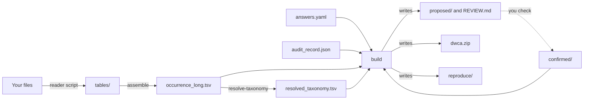

# Concepts

The words these pages use, each with one meaning.

Every conversion passes through the intermediate table. `build` reads only the files on its left and the files they name, so it gives the same archive every time from the same files.

## Your data

**Feature**: one ASV or OTU, a distinct sequence your pipeline resolved, identified by `featureID`. A feature has a taxonomic assignment, and isn't itself a taxon.

**Sample**: what was sequenced, identified by `sampleID`. Two PCR replicates of one water sample are two samples, never one with their counts added together.

**Event**: one collection at one place and time, identified by `eventID`. Every sample taken from it shares that `eventID`.

**Marker**: the amplified region, with the primer pair that amplifies it. A dataset often has several. A marker's name doesn't say what it amplifies: "16S" is both a bacterial target and a vertebrate mitochondrial one, so `answers.yaml` asks.

**Library**: one sample amplified with one marker and sequenced. Read totals, and so `sampleSizeValue`, are per library.

**Control**: a sample that measures contamination rather than biology: a field blank, an extraction blank, a PCR negative, a positive control or a mock community. Controls are removed before publication.

**Targeted assay**: qPCR or ddPCR against one organism, with a validated limit of detection. Only here is a non-detection evidence of absence. Everything else is **metabarcoding**, which publishes presences only.

## The archive

**Darwin Core Archive (DwC-A)**: the zip GBIF and OBIS accept, `dwca.zip`: a core table, its extensions, a `meta.xml` describing them and an `eml.xml` describing the dataset.

**Occurrence**: one detection, a feature in a sample. One row of the archive's core table.

**Term**: a Darwin Core or MIxS field name, such as `scientificNameID` or `env_broad_scale`.

**Extension**: a table beside the core, joined to it by `occurrenceID`. The tool writes DNADerivedData, for sequences and sequencing metadata, and eMoF, for measurements.

**Placeholder taxon**: `Biota incertae sedis`, the name published for a feature with no taxonomic assignment. It is a real WoRMS entry, not an invented value.

## A conversion

**Conversion**: everything that takes one dataset from raw files to a checked archive, in one directory.

**Reader script**: the short script, written for your files, that reads them into plain tables. `assemble` joins those tables into the intermediate table.

**Intermediate table**: `occurrence_long.tsv`, one row per sample and feature. Every conversion passes through it, whatever its input format.

**Answer**: something only a person can say about the dataset, written in `answers.yaml`, such as the dataset metadata or what each marker amplifies. `build` stops until each one it needs is given. [A conversion](commands.md#a-conversion) lists them.

**Provenance and confirmation**: every answer has a `provenance`, saying what its value rests on, such as `methods.pdf p4, MiFish primers`, and a `confirmed`, holding a person's reply or nothing. An answer with `confirmed` empty holds the build for review. See [Provenance and confirmation](metadata.md#provenance-and-confirmation).

**Proposal**: a table the tool produced for you to check, written to `proposed/` on every build: the control roster, the term mapping, the taxonomy and some derived values.

**Confirmed sheet**: a file in `confirmed/` with a proposal's header and only the rows you changed. A header alone accepts the proposal. The control roster has none: answers under `controls:` settle it. See [Reviewing a proposal](commands.md#reviewing-a-proposal).

**Taxonomy lock**: `resolved_taxonomy.tsv`, which `resolve-taxonomy` writes from WoRMS and GBIF and `build` reads, so `build` doesn't call a register.

**Finding**: one coded statement of what a step did or couldn't do, such as `COUNTRY_CODE_FROM_NEARBY_COAST`. Most findings only inform. An error finding stops the build, and `ADJUDICATION_NEEDED` waits for an answer under `adjudications:`. See [Finding codes](findings.md).

**Term state**: what the conversion recorded about each term: **Filled**, **Ask** (a person has to supply it), **Impossible** (no source has it) or **Not-applicable**. See [Term states](term-mapping.md#term-states).

**Reproduce bundle**: `reproduce/`, beside `dwca.zip`, with what `replay` needs to rebuild the archive. See [Reproducibility](reproducibility.md).

## The pages

`inspect` writes `INSPECTION.md`, about your raw files. `build` writes `REVIEW.md` every time, listing what is waiting on you. `evaluate` writes `EVALUATION.md` about a finished archive. Each has an HTML copy. `CONVERSION_REPORT.md`, beside `dwca.zip`, says what the conversion did and couldn't do, and goes with the archive.
